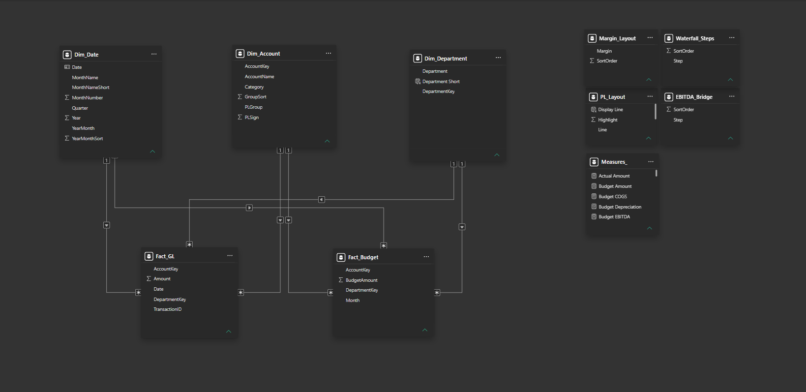

# Data Model

## Model overview

The Financial P&L Dashboard uses a shared-dimension model with separate fact tables for actual financial transactions and monthly budgets. Both fact tables connect to shared Date, Account, and Department dimensions, enabling consistent filtering and Actual vs. Budget comparisons across the three report pages.

## Fact tables

| Table | Description |
| --- | --- |
| `Fact_GL` | Stores actual financial transactions, including transaction amount, date, account, department, and transaction identifier. |
| `Fact_Budget` | Stores budget amounts by month, account, and department. |

The two fact tables remain separate because actual transactions are recorded by transaction date, while budget figures are recorded at a monthly level.

## Shared dimensions

| Table | Role |
| --- | --- |
| `Dim_Date` | Provides calendar dates and attributes used for Year and Month filtering and prior-year comparisons. |
| `Dim_Account` | Defines account names and financial groupings used to calculate Revenue, COGS, OPEX, and other P&L lines. |
| `Dim_Department` | Provides department categories for operating expense and budget analysis. |

## Relationships

The model has six active, many-to-one (`*:1`) relationships, with single-direction filtering from each dimension to the corresponding fact table.

| Fact table column | Dimension column |
| --- | --- |
| `Fact_GL[Date]` | `Dim_Date[Date]` |
| `Fact_GL[AccountKey]` | `Dim_Account[AccountKey]` |
| `Fact_GL[DepartmentKey]` | `Dim_Department[DepartmentKey]` |
| `Fact_Budget[Month]` | `Dim_Date[Date]` |
| `Fact_Budget[AccountKey]` | `Dim_Account[AccountKey]` |
| `Fact_Budget[DepartmentKey]` | `Dim_Department[DepartmentKey]` |

Shared dimensions allow the same Year, Month, Account, and Department selections to filter both actual and budget data.

## Monthly budget granularity

`Fact_Budget[Month]` stores the **first calendar day of each budget month** as a date, for example `2025-01-01` and `2025-02-01`. Its relationship to `Dim_Date[Date]` therefore preserves both month and year.

Budget values are intended for month-level reporting. A custom day-level filter that excludes the first day of a month can exclude that month's budget records, so the report uses Year and Month selections for its financial comparisons.

## Reporting and layout tables

The semantic model also contains disconnected tables used to organize specialized report visuals:

| Table | Purpose |
| --- | --- |
| `PL_Layout` | Controls the P&L statement lines, display labels, sort order, and favorable/unfavorable variance direction. |
| `Margin_Layout` | Selects Gross Margin, EBITDA Margin, and Net Margin rows in the profitability comparison. |
| `Waterfall_Steps` | Provides the categories for the Revenue-to-Net-Profit bridge. |
| `EBITDA_Bridge` | Provides the steps for the budget-to-actual EBITDA waterfall. |
| `Measures_` | Organizes the report's DAX measures. |

The layout tables do not require physical relationships to the fact tables. DAX measures interpret the selected layout row using functions such as `SELECTEDVALUE`, `SWITCH`, and `TREATAS`.

## Calculation approach

Base measures aggregate the actual amounts in `Fact_GL` and budget amounts in `Fact_Budget`. Other measures calculate financial KPIs, prior-year comparisons, and budget variances from those aggregates. The custom P&L layout applies line-specific favorable/unfavorable sign conventions so that the statement can consistently distinguish positive and negative performance.

See [DAX Measures & Calculation Logic](dax-measures.md) for selected measure definitions.
